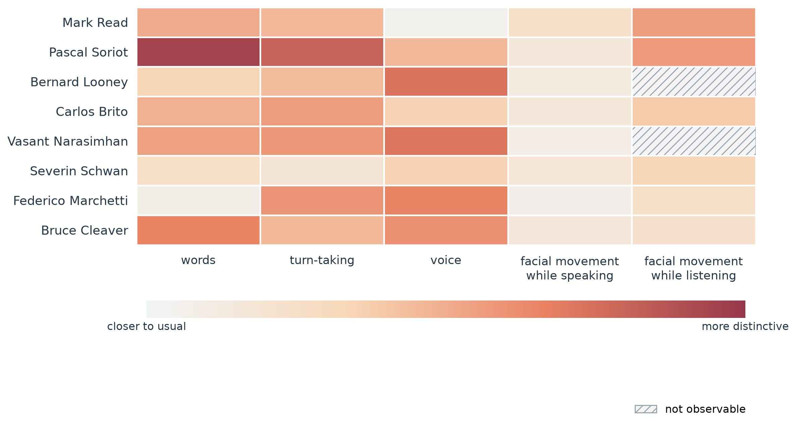

# Repeated-interviewer measurement demonstration

[Home](../README.md) / [Documentation](README.md) / Repeated interviewer

## Sample and result

This is a separate sample of eight *Leaders with Lacqua* interviews (192.4 minutes), with no video IDs overlapping the 30-interview production archive. The same interviewer is compared across encounters with different CEOs. [Source manifest](../data/derived/repeated_interviewer/manifest.csv).

Transcript features, turn timing, voice, and visible behavior yield different profiles. Federico Marchetti's interview has transcript departure 0.170, interaction-timing departure 1.181, and vocal-delivery departure 1.313. These are descriptive contrasts, not psychological labels or tests of cross-channel independence.

## Measurement rules

Transcript features are median words per turn, variation in turn length, and moving-average lexical diversity over 50-word windows. Timing uses turn duration, response latency, interviewer speech share, and silent-pause frequency. Voice uses speaking rate, pitch variability, intensity variability, and filler frequency. The [episode inputs](../data/derived/repeated_interviewer/francine_audio_transcript_profiles.csv) contain these numeric features without transcript text.

For each nonvisual feature, subtract the equal-weight mean of the other seven episodes, divide by the sample standard deviation across all eight episodes, and combine standardized departures within a channel using their root mean square. Baseline means exclude the target episode; the scaling standard deviation includes it. These are in-sample descriptions, not out-of-sample predictions.

Visible features are low-level face-configuration coefficients (smile configuration, brow raising/lowering, eye widening/squinting, jaw opening, and mouth pressing). They are not emotion labels. Measurements are adjusted for face size, multiple-face framing, and identity-match strength, retaining speaking/listening state in the adjustment. Model-fitting adjustments use the full observed sample.

Speaking and listening are scored separately. A score requires at least eight verified measurable frames per episode and state: eight episodes qualify for speaking and six for listening. Baseline means therefore use seven other episodes for speaking and five for listening. Each episode receives equal weight in the baseline, while feature scaling uses pooled observed frames in the relevant state. [Feature calibration](../data/derived/repeated_interviewer/visual_feature_calibration.csv) provides episode means, pooled standard deviations, and counts for reconstructing these composites. [Visible scores](../data/derived/repeated_interviewer/francine_speaker_state_deviations.csv) also retain the original 2,000-resample, 30-second-block bootstrap intervals; these quantify frame-sampling uncertainty, not causal uncertainty.

Blank/hatched cells mean insufficient observable evidence for a score. Some frames may be available even when the minimum is not met. [Coverage](../data/derived/repeated_interviewer/francine_speaker_state_coverage.csv).

## Production sensitivity

The [specification comparison](../data/derived/repeated_interviewer/video_episode_comparison.csv) contrasts zero-filled full-grid observations, observed-only targeted frames, and targeted frames adjusted for face size, multiple faces, identity-match strength, and proximity to camera cuts. These specifications change both visibility handling and sampling/adjustment; their differences do not isolate a single causal effect.

Compare ranks among the six interviews eligible under both zero-filling and production adjustment. Pascal Soriot's interview moves from fifth to first in that common set. Zero-filling alone yields scores for all eight interviews; comparing raw ranks across different eligible sets would be misleading. The adjusted specification has 444 usable listening frames. Removing frames within two seconds of a cut leaves only two eligible interviews, insufficient for the minimum three-episode comparison. [Sensitivity summary](../data/derived/repeated_interviewer/video_production_aware_summary.json).

## Oversight and limits

Automatic speaker-role labels required correction in six of eight episodes. The [role audit](../data/derived/repeated_interviewer/francine_speaker_role_audit.csv) and [correction log](../data/derived/repeated_interviewer/speaker_role_overrides.csv) omit verbatim quotations but retain the assignments and reasons. Topic, year, production, visibility, and model errors may contribute to departures. Eight episodes demonstrate construction, not population representativeness or validated constructs.

## Reproduce the released profiles

Run `python3 scripts/verify_submission_evidence.py`. It reconstructs nonvisual and visual composites from the released numeric inputs, verifies sample separation, checks paired-score counts, and validates the common-sample rank comparison. It uses only Python's standard library.

To redraw Figure 3, run `python3 scripts/build_submission_video_figure.py` with Matplotlib and NumPy installed. Source media, frame images, verbatim transcripts, and face embeddings are excluded. These checks reproduce derived profiles; they do not rerun transcription, identity verification, or face extraction from source recordings.
