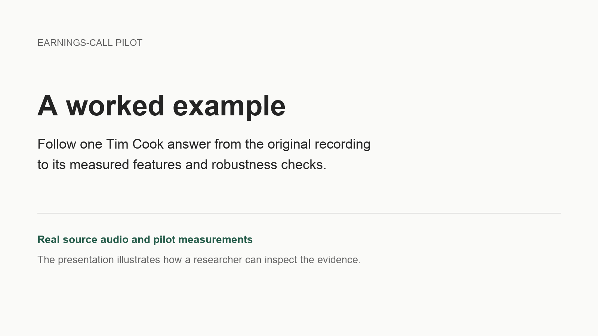

# A worked example from the earnings-call pilot

[Home](../README.md) / [Documentation](README.md)

[Watch the 84-second video](media/researcher_walkthrough.mp4) · [Captions](media/researcher_walkthrough_captions.srt) · [Exported measurement row](../data/derived/worked_example_measure.csv)

The video follows one Tim Cook answer from Apple's FY2026 Q1 earnings call. It uses the original 22.874-second audio excerpt, the retained pilot transcript, and the released measurements. Short passages recorded by the author guide the demonstration. The presentation illustrates evidence inspection; it does not show a completed guided interface processing a new recording.

## What the example shows

1. Read the transcript while listening to the original answer.
2. Compare the transcript-visible departure score of **0.269** with the audio/interaction score of **2.574**.
3. Inspect measured intensity, pitch, and word-gap features alongside the same-call Q&A medians.
4. Check alternative specifications: the audio/interaction score remains above 2.0 when timing and speaking rate, pitch, or intensity are excluded separately.
5. Export an observation that retains the call identifier, source interval, scores, and reference design.

This answer meets the pilot's illustrative review rule: audio/interaction departure of at least 2.0 and transcript-visible departure of no more than 1.25. The thresholds identify cases to inspect; they are not validated psychological boundaries.

## Follow the observation back to the evidence

The call identifier is `AAPL_2026_Q1`, source segment `13`, at **1796.206–1819.080 seconds** in the retained source recording (29:56.206–30:19.080). The same observation is recorded in the [released answer scores](../data/derived/expanded_audio_answer_scores.csv) and [case robustness table](../data/derived/expanded_audio_primary_examples_robustness.csv). The [exported row](../data/derived/worked_example_measure.csv) reproduces those scores and records the source interval.

The underlying measurements come from the existing pilot outputs. Audio level is normalized for playback; the video does not recalculate measurements from the playback audio. The example includes only this short source excerpt and its transcript, rather than the full call or source archive.

## How to interpret the measurements

The transcript-visible score uses answer length, filled pauses, discourse fillers, and adjacent repetitions. It does not represent semantic content, sentiment, or every possible transcript-based measure.

Recording-sensitive acoustic features are referenced to prepared remarks in the same call. Answer features are then centered at that call's Q&A median and compared with answer residuals from Cook's other calls, excluding the target call from the personal reference distribution. These retrospective references include earlier and later calls. The [technical appendix](submission_technical_appendix.md) explains the full scoring design.

The scores describe observable departures. They do not establish emotion, intent, deception, or executive quality. Robustness to the displayed feature exclusions does not establish construct validity.

## Applying the approach to another study

Researchers specify the construct, unit of analysis, observations, comparison baseline, exclusions, treatment of unavailable information, and validation plan. They inspect source-linked examples, correct errors or revise measurement choices, compare reasonable specifications, and export documented measures.

The [measure-specification prototype](../tools/measure-specification-prototype/README.md) supports specifying and exporting measurement choices. A guided interface for independently processing new recordings remains part of Stage 2. Researchers remain responsible for construct definition, measurement design, validation, and inference.

[Earnings-call pilot](earnings_call_pilot.md) · [Methods and limitations](submission_technical_appendix.md) · [Reproduction requirements](reproducibility.md)
